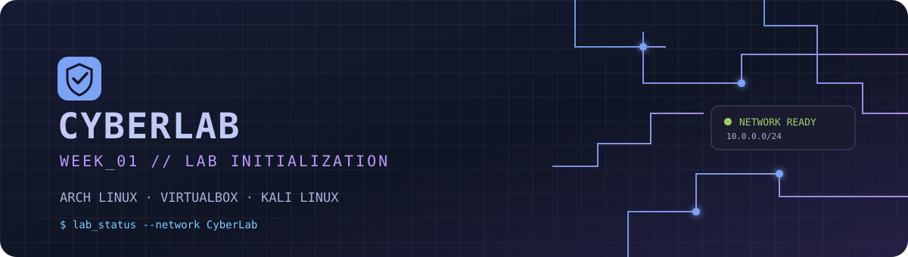
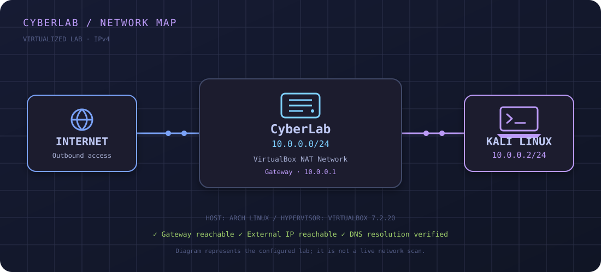
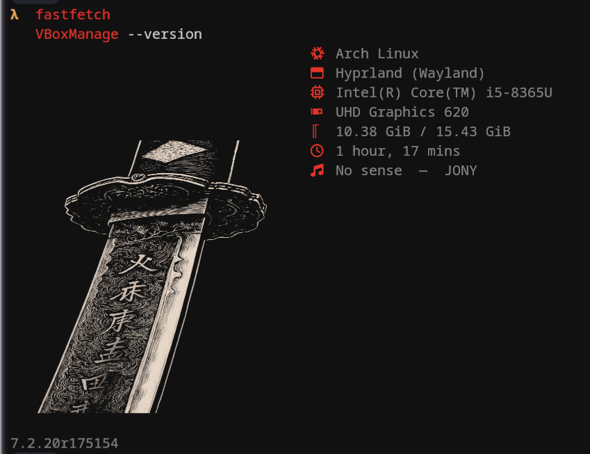
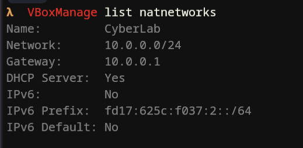
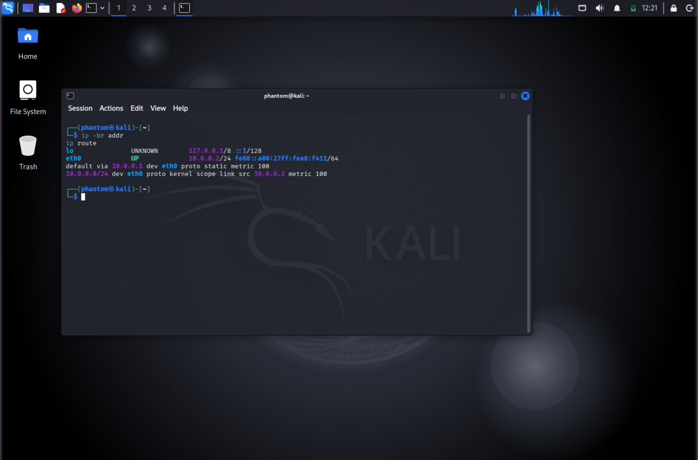
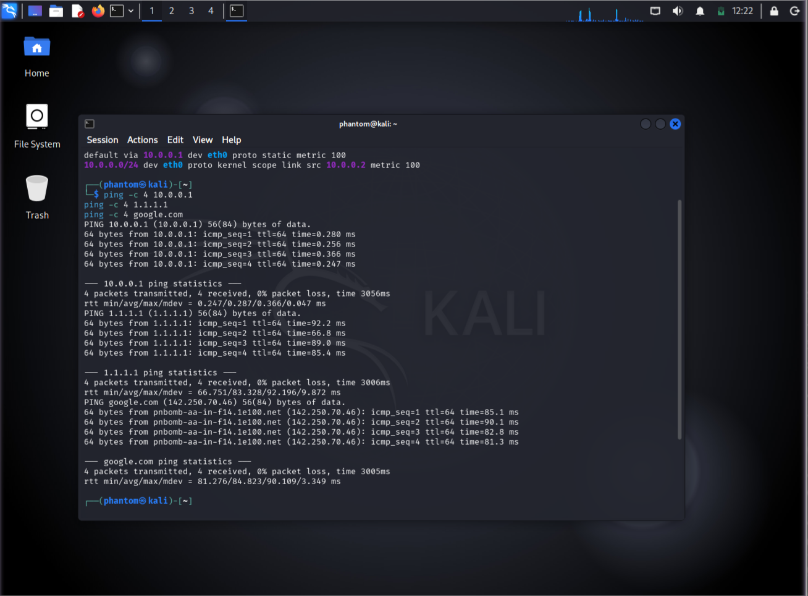
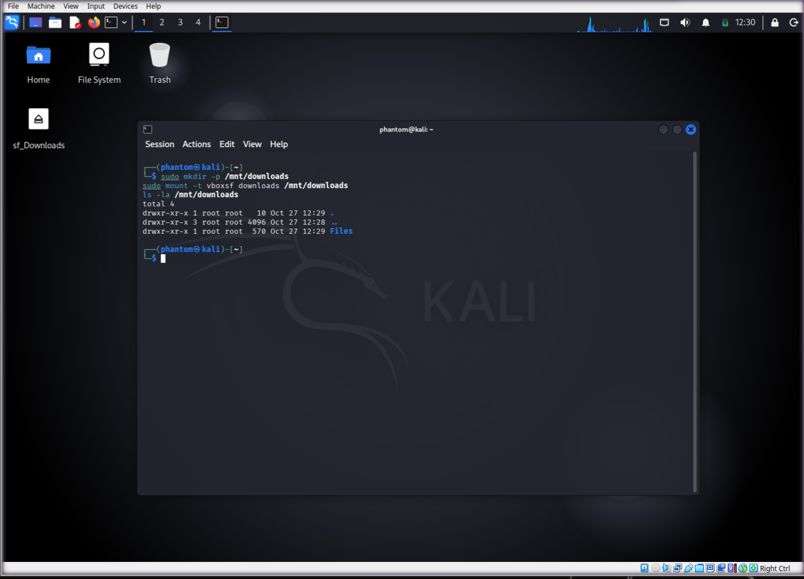
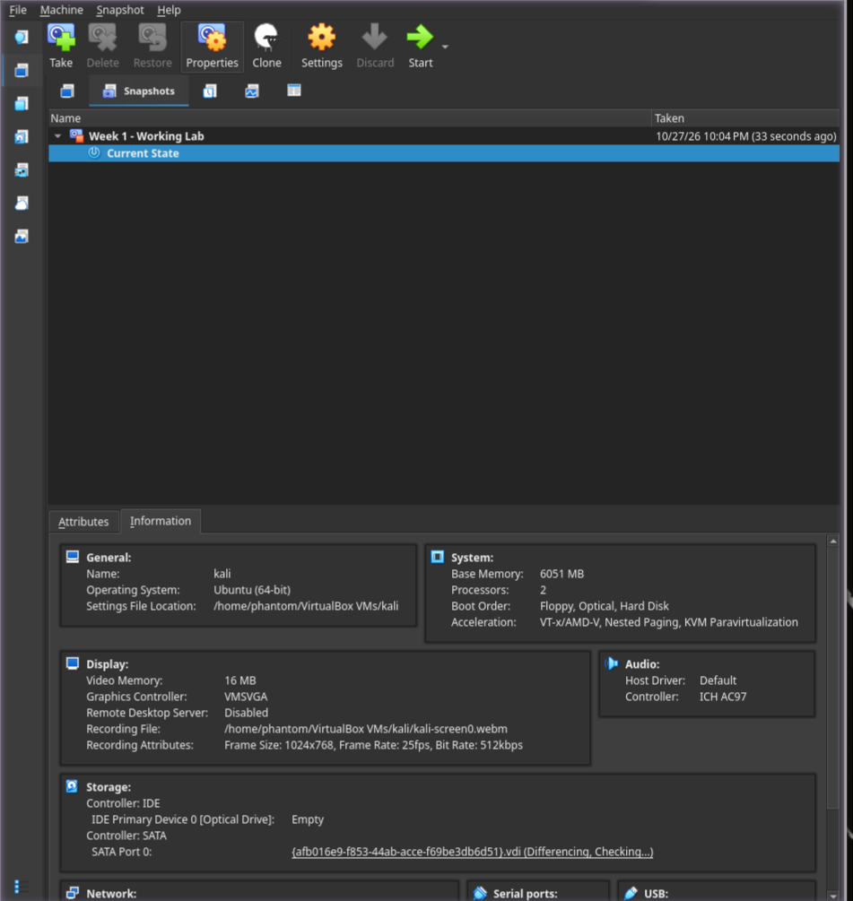

 <div align="center">



# `CYBERLAB / WEEK_01`

### Virtual Cybersecurity Lab · Arch Linux × VirtualBox × Kali Linux

  

**A documented, reproducible virtual lab for learning networking and cybersecurity fundamentals.**

`OVERVIEW` · `ARCHITECTURE` · `BUILD LOG` · `VALIDATION` · `EVIDENCE`

</div>

---

## `01` // Overview

This project documents the setup of a Kali Linux virtual machine on an **Arch Linux host** using Oracle VirtualBox. The guest connects through a dedicated VirtualBox NAT Network named `CyberLab`.

The lab demonstrates virtual machine configuration, IPv4 networking, DNS resolution, connectivity testing, shared-folder integration, and snapshot management.

> [!NOTE]
> This is an educational lab. Perform security testing only on systems and networks you own or have explicit permission to test.

### Lab specifications

| Component | Configuration |
|:--|:--|
| Host OS | Arch Linux |
| Host device | Dell Latitude 5400 |
| CPU | Intel Core i5-8365U |
| Memory | Approximately 15 GiB RAM |
| Storage | Toshiba NVMe SSD, approximately 477 GB reported |
| Hypervisor | Oracle VirtualBox `7.2.20r175154` |
| Guest OS | Kali Linux |
| Virtual machine | `kali` |
| Network | `CyberLab` — NAT Network |
| Guest interface | `eth0` |
| Guest IPv4 | `10.0.0.2/24` |

---

## `02` // Network architecture

<div align="center">
  
</div>

### IPv4 address plan

| Setting | Value |
|:--|:--|
| Network name | `CyberLab` |
| Subnet | `10.0.0.0/24` |
| Virtual gateway | `10.0.0.1` |
| Kali guest address | `10.0.0.2/24` |
| DNS resolvers | `1.1.1.1`, `8.8.8.8` |
| Virtual adapter | NAT Network |
| DHCP | Enabled on the NAT Network; Kali uses a manually configured IPv4 address |

The Kali guest uses a static IPv4 configuration so its lab address remains predictable. The VirtualBox NAT Network provides outbound connectivity.

---

## `03` // Build log

The following commands document the setup. Run host commands on **Arch Linux** and guest commands inside **Kali Linux**.

### 01 — Create and start the NAT Network

On the Arch Linux host:

```bash
VBoxManage natnetwork add \
  --netname "CyberLab" \
  --network "10.0.0.0/24" \
  --enable

VBoxManage natnetwork modify \
  --netname "CyberLab" \
  --dhcp on

VBoxManage natnetwork start \
  --netname "CyberLab"
```

Inspect the configuration:

```bash
VBoxManage list natnetworks
```

The expected network name is `CyberLab`, with subnet `10.0.0.0/24` and gateway `10.0.0.1`.

### 02 — Attach Kali to CyberLab

Power off the VM before changing its network adapter.

```bash
VBoxManage modifyvm "kali" \
  --nic1 natnetwork \
  --nat-network1 "CyberLab"
```

### 03 — Configure the Kali guest

Inside Kali, configure the NetworkManager connection named `Wired connection 1`:

```bash
sudo nmcli connection modify "Wired connection 1" \
  ipv4.method manual \
  ipv4.addresses 10.0.0.2/24 \
  ipv4.gateway 10.0.0.1 \
  ipv4.dns "1.1.1.1 8.8.8.8"
```

During initial network troubleshooting, the duplicate-address-detection timeout adjustment from the lab worksheet was also applied:

```bash
sudo nmcli connection modify "Wired connection 1" \
  ipv4.dad-timeout 0

sudo nmcli connection down "Wired connection 1"
sudo nmcli connection up "Wired connection 1"
```

### 04 — Inspect the network state

```bash
ip -br addr
ip route
cat /etc/resolv.conf
```

Expected key details:

```text
eth0    UP    10.0.0.2/24
default via 10.0.0.1
```

Additional IPv6 addresses and routes may also appear.

---

## `04` // Connectivity validation

Three connectivity checks were performed from the Kali guest.

```bash
# Check the virtual gateway
ping -c 4 10.0.0.1

# Check outbound IP connectivity
ping -c 4 1.1.1.1

# Check DNS resolution and connectivity
ping -c 4 google.com
```

### Results

| Test | Observed result |
|:--|:--|
| Gateway — `10.0.0.1` | 4 received, 0% packet loss |
| External IP — `1.1.1.1` | 4 received, 0% packet loss |
| DNS — `google.com` | 4 received, 0% packet loss |

<details>
<summary><strong>Example terminal output</strong></summary>

```text
4 packets transmitted, 4 received, 0% packet loss
```

The result above summarizes the successful tests. Refer to the connectivity screenshot in the evidence gallery for the actual terminal output.

</details>

### DNS troubleshooting

Initially, the guest could reach the gateway and an external IP address, but domain resolution failed.

The DNS servers were changed to `1.1.1.1` and `8.8.8.8`, the NetworkManager connection was restarted, and `google.com` resolved successfully.

---

## `05` // Virtual machine integration

The lab also includes shared-folder access and a saved VM snapshot.

| Feature | Documented state |
|:--|:--|
| CyberLab NAT Network | Configured |
| Static guest IPv4 | Verified |
| Internet and DNS | Verified |
| Downloads shared folder | Mounted and accessible inside Kali |
| VM snapshot | `Week 1 - Working Lab` created |
| Bidirectional clipboard | Verify before submission |
| Drag-and-drop | Verify before submission |

### Shared Downloads folder

The host Downloads directory is:

```text
/home/phantom/Downloads
```

The VirtualBox shared-folder name is `downloads`. Inside Kali, the share was mounted at `/mnt/downloads`:

```bash
sudo mkdir -p /mnt/downloads
sudo mount -t vboxsf downloads /mnt/downloads

ls -la /mnt/downloads
```

The mounted directory was accessible and contained a `Files` directory when checked.

The Kali desktop also displayed the `sf_Downloads` shared-folder icon.

### Snapshot

A VirtualBox snapshot named:

```text
Week 1 - Working Lab
```

was created to preserve a configured lab state. The snapshot is visible in VirtualBox's Snapshots view.

A snapshot is a recovery point for the VM; it is not a replacement for a separate backup.

---

## `06` // Troubleshooting notes

<details>
<summary><strong>Guest interface did not receive an IPv4 address</strong></summary>

The NetworkManager connection was configured with a static address, gateway, and DNS servers. The connection was then cycled. The `ipv4.dad-timeout 0` adjustment from the lab worksheet was also applied during troubleshooting.

</details>

<details>
<summary><strong>IP connectivity worked but DNS failed</strong></summary>

The guest could reach `10.0.0.1` and `1.1.1.1`, but domain resolution initially failed. The connection's DNS resolvers were updated to `1.1.1.1` and `8.8.8.8`, then connectivity was tested again.

</details>

<details>
<summary><strong>VirtualBox network settings could not be changed</strong></summary>

Power off the VM before modifying its network adapter. Select the intended NAT Network, save the settings, and start the VM again.

</details>

<details>
<summary><strong>Shared folder is unavailable inside Kali</strong></summary>

Confirm that the shared-folder entry exists in VirtualBox settings, that the share name matches the mount command, and that VirtualBox Guest Additions support is available in the guest.

</details>

---

## `07` // Evidence gallery

The following images use the actual screenshot filenames supplied for this project. Upload each image to the repository's `screenshots/` directory so the relative paths resolve.

<table>
  <tr>
    <td width="50%">
      <strong>01 · Host & hypervisor</strong><br>
      <sub>Arch Linux host and VirtualBox version</sub><br><br>
      
    </td>
    <td width="50%">
      <strong>02 · NAT Network</strong><br>
      <sub>CyberLab subnet and gateway</sub><br><br>
      
    </td>
  </tr>
  <tr>
    <td width="50%">
      <strong>03 · Kali interface</strong><br>
      <sub>Guest IPv4 address and default route</sub><br><br>
      
    </td>
    <td width="50%">
      <strong>04 · Connectivity tests</strong><br>
      <sub>Gateway, external IP and DNS checks</sub><br><br>
      
    </td>
  </tr>
  <tr>
    <td width="50%">
      <strong>05 · Shared folder</strong><br>
      <sub>Downloads share mounted inside Kali</sub><br><br>
      
    </td>
    <td width="50%">
      <strong>06 · Snapshot</strong><br>
      <sub>Week 1 - Working Lab saved state</sub><br><br>
      
    </td>
  </tr>
</table>

---

## `08` // Repository layout

```text
week1-cybersecurity-lab/
├── README.md
├── assets/
│   ├── tokyo-night-banner.svg
│   └── network-topology.svg
└── screenshots/
    ├── 2026_10_27_16_19_21_screenshot.png
    ├── 2026_10_27_16_20_05_screenshot.png
    ├── 2026_10_27_16_21_17_screenshot.png
    ├── 2026_10_27_16_22_13_screenshot.png
    ├── 2026_10_27_16_30_18_screenshot.png
    └── 2026_10_27_16_34_52_screenshot.png
```

The SVG files are custom visual assets for the Tokyo Night theme. Keep their names and paths unchanged unless you also update the corresponding README references.

---

## `09` // Learning outcomes

- Creating and configuring a VirtualBox NAT Network.
- Assigning IPv4 addresses and configuring a default gateway.
- Understanding DNS resolution and outbound connectivity.
- Troubleshooting a Linux guest's network configuration.
- Integrating a host directory with a virtual machine.
- Creating a snapshot for VM recovery.
- Documenting technical work with commands, results, and screenshots.

<div align="center">

---

<sub><code>CYBERLAB / WEEK_01</code> · Built for learning · Documented on Arch Linux</sub>

<sub>Tokyo Night · Dark blue / purple · Virtual lab documentation</sub>

</div>
